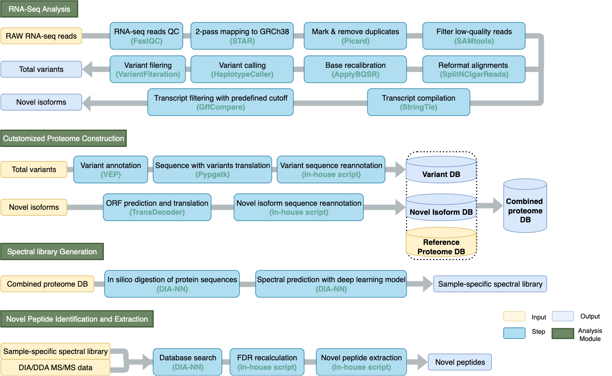

[](https://www.nextflow.io/)
[](https://docs.conda.io/en/latest/)
[](https://www.docker.com/)
[](https://sylabs.io/docs/)

# PG-DIA

PG-DIA is a Nextflow DSL2 workflow for building customized protein databases from RNA-seq and searching matched DIA-MS data against those databases. This implementation combines RNA-seq variant calling, transcript assembly, novel isoform ORF prediction, protein database assembly, and novel peptides reporting in one pipeline.



## What the pipeline does

For each sample, the workflow:

1. Accepts RNA-seq input as FASTQ, BAM, or CRAM together with one DIA raw file path.
2. Runs the RNA variant branch to produce BAMs and annotated VCFs.
3. Converts annotated variants into variant peptide FASTA entries with `pypgatk`, then annotates amino acid changes.
4. Runs StringTie on the RNA-seq alignment output.
5. Runs `gffcompare`, filters novel transcript models, extracts transcript FASTA with `gffread`, and predicts ORFs with TransDecoder.
6. Combines the reference proteome, variant peptides, and novel isoform peptides into per-sample protein databases.
7. Runs DIA-NN against the per-sample combined FASTA.
8. Post-processes the DIA-NN parquet report into reference and novel peptide/protein matrices.

This is a sample-matched workflow: each RNA-seq sample is paired to one DIA raw input and yields its own customized database and DIA-NN output.

A small [simulated DIA-MS fixture](examples/runnable_example/README.md) is included for local file-ingestion and DIA-NN integration testing.

## Inputs

### Samplesheet

The full PG-DIA workflow expects one row per sample with:

- one RNA-seq input mode: `fastq_1`/`fastq_2`, or `bam`/`bai`, or `cram`/`crai`
- one DIA input path in `dia_raw`

An example samplesheet for this branch looks like this:

```csv
sample,fastq_1,fastq_2,bam,bai,cram,crai,dia_raw,strandedness
SAMPLE_A,/data/rna/SAMPLE_A_R1.fastq.gz,/data/rna/SAMPLE_A_R2.fastq.gz,,,,,/data/dia/SAMPLE_A.d,unstranded
SAMPLE_B,,,/data/rna/SAMPLE_B.markdup.bam,/data/rna/SAMPLE_B.markdup.bam.bai,,,/data/dia/SAMPLE_B.RAW,unstranded
SAMPLE_C,,,,,/data/rna/SAMPLE_C.cram,/data/rna/SAMPLE_C.cram.crai,/data/dia/SAMPLE_C.d,unstranded
```

Column notes:

| Column | Required | Description |
| --- | --- | --- |
| `sample` | Yes | Sample identifier. Multiple FASTQ lanes for the same sample may reuse the same name. |
| `fastq_1`, `fastq_2` | Conditional | RNA-seq FASTQs. Use these if starting from raw reads. |
| `bam`, `bai` | Conditional | Coordinate-sorted BAM and index if alignment is already done. |
| `cram`, `crai` | Conditional | CRAM and CRAI if starting from CRAM instead of BAM. |
| `dia_raw` | Yes | DIA-MS raw path for the sample, for example a timsTOF `.d` directory or vendor raw file. |
| `strandedness` | Yes | Passed to StringTie. Supported values are `forward`, `reverse`, and `unstranded`. |


### Required reference and workflow parameters

At minimum, plan to provide:

- `--input`
- `--outdir`
- `--protein_reference_db`
- either `--genome` with a configured reference bundle, or explicit `--fasta` and `--gtf`
- `--read_length` when aligning from FASTQ

For the RNA variant branch:

- provide `--dbsnp` and/or `--known_indels` if you want base recalibration
- otherwise set `--skip_baserecalibration`

## Quick start

For a repository-local test using simulated RNA-seq, variant, reference, and
DIA-MS inputs, follow the [runnable example tutorial](examples/runnable_example/README.md):

```bash
nextflow run main.nf -profile test,docker --outdir results/test
```

The tutorial includes DIA-NN image and executable-path configuration, a
configuration preview, expected outputs, and fixture-regeneration commands.

For user data, run from the repository root:

```bash
nextflow run bzhanglab/pgdia \
  -profile docker \
  --input samplesheet.csv \
  --outdir results \
  --genome GRCh38 \
  --read_length 151 \
  --protein_reference_db /path/to/reference_proteome.fa \
  --skip_baserecalibration
```

If you have known sites for GATK RNA recalibration, use them instead of skipping BQSR:

```bash
nextflow run bzhanglab/pgdia \
  -profile docker \
  --input samplesheet.csv \
  --outdir results \
  --genome GRCh38 \
  --read_length 151 \
  --protein_reference_db /path/to/reference_proteome.fa \
  --dbsnp /path/to/dbsnp.vcf.gz \
  --known_indels /path/to/known_indels.vcf.gz 
```

Useful runtime options:

- `-profile docker`, `-profile singularity`, `-profile conda`, or `-profile mamba`
- `-resume` to continue from a previous run
- `--diann_image` to point to a DIA-NN container image name or tarball; download the [DIA-NN 2.0.2 image](https://aws2.zhang-lab.org/diann-2.0.2.tar.gz)
- `--diann_bin` if the DIA-NN executable path inside the image differs from the default
- `--diann_cpus` to control DIA-NN threads

### Paired-entrapment assessment

Add `--paired_entrapment` to run a separate per-sample assessment alongside the
standard search. PG-DIA digests the reference and novel FASTAs into 7–30 residue
peptides, collapses I/L-equivalent novel identities, and generates one random
composition-preserving shuffle per retained novel target with its final residue
fixed. Shuffles matching anywhere in either input FASTA are rejected. Proven
unshufflable targets are excluded with reasons. The seed defaults to `20260817`;
`--entrapment_missed_cleavages` defaults to `1` and accepts `0`, `1`, or `2`.

The separate DIA-NN search disables cleavage and methionine excision, retains
search decoys, and treats entrapments as search targets. By default, complete
`Global.Q.Value` score ties enter cumulative D/T together and reverse cumulative
minima give empirical precursor q-values. `--entrapment_cutoff` defaults to
`0.001`. Use `--entrapment_q_column Global.Peptidoform.Q.Value` to change the
ranking, or `--entrapment_recalculate_q false` to use the supplied q-values.

The assessment collapses charges, modifications, and runs to unmodified peptide
sequences. It reports `(N_E + N_E_only + 2*N_E_better_both)/(N_T + N_E)` for the
combined novel-target/entrapment list. Tied accepted partners cause an error
because their ordering is unresolved. This FDP estimate does not establish
novel-target-only FDR at the nominal precursor cutoff. Outputs, including the
search report, pair mapping, input hashes, exclusions, summary, and method metadata,
are published under `paired_entrapment/<sample>/`.

## Reference configuration

The bundled `conf/igenomes.config` defines specific `--genome GRCh38` entry pointing to:

- genome FASTA
- annotation GTF
- STAR index
- VEP cache metadata

If you do not want to use that bundle, provide explicit reference files with parameters such as:

- `--fasta`
- `--fasta_fai`
- `--dict`
- `--gtf`
- `--star_index`
- `--dbsnp`
- `--known_indels`

`--read_length` matters for STAR index generation and alignment. Set it to the actual read length of the RNA-seq data, for example `151` for 2x151 bp libraries.

## Main outputs

Published results are written under `--outdir` and typically include:

| Path | Contents |
| --- | --- |
| `reports/` | MultiQC output and annotation summary reports |
| `pipeline_info/` | Nextflow execution metadata, params, and software versions |
| `annotation/<sample>/` | Annotated and decompressed VCF outputs from the RNA variant branch |
| `stringtie/` | Per-sample StringTie GTF assemblies |
| `isoform_db/<sample>/` | Predicted peptide FASTA from novel isoforms |
| `protein_db/<sample>/` | `<sample>_combined_protein_db.fa` and `<sample>_novel_protein_db.fa` |
| `diann_output/<sample>/` | DIA-NN parquet report, matrices parquet, per-run transition XIC parquet files, and postprocessed novel/reference TSV matrices |

DIA-NN is run with `--xic`, which publishes transition-level chromatograms as
`diann_output/<sample>/<sample>_report_xic/*.xic.parquet`. Use
[`bin/plot_diann_xic.py`](bin/plot_diann_xic.py) to extract one precursor from
these files, export its transition-level values, and generate per-run and
combined XIC plots. See [the output documentation](docs/output.md#dia-nn-results-and-transition-xics)
for the input columns and a reproducible command.


## Credits

PG-DIA in this repository was written and adapted by Wenrong Chen in the Zhang Lab, building on nf-core components.

## Citation

See [CITATIONS.md](CITATIONS.md) for software and workflow citation details.
